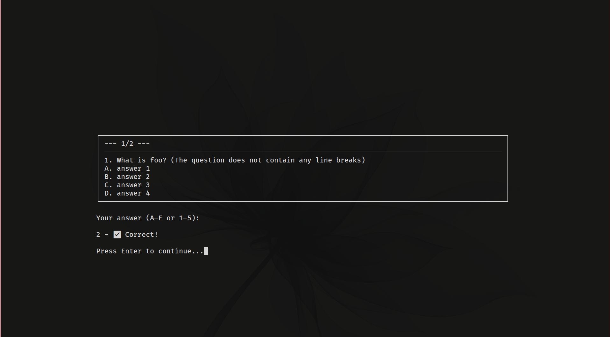

# Multiple-Choice

Simpler than Quizizz.

# Usage
- Import your file with the same structure as **Questions.txt** file: put it next to `app.py`, or upload it on the menu screen (UTF-8 .txt or .docx, max 10 MB, not saved).
- The web app also accepts common variations: `Câu 1:` / `1)` numbering, `a)` / `(A)` options, several options on one line, questions wrapped over lines, `Đáp án: B` / `Answer: B` lines, a `*` on the correct option, or an answer key at the end (`Đáp án:` then `1-B, 2-A ...`). `.docx` files work too (type the question numbers; Word's automatic numbering isn't read). After uploading you can download the file converted to the standard format.
- Run `python app.py` — the quiz opens in your browser at http://127.0.0.1:8000.
- Answer by clicking, or press `A`–`E` / `1`–`5`; `Enter` goes to the next question.
- Options: shuffle questions or answers, missed questions come back until you get them right, grade at the end. A stopwatch shows elapsed time.
- Your score history per question set is saved in the browser.
- Click the image icon (top right) to set a background image and adjust blur, opacity and brightness. Saved in your browser only.
- Run `python test_app.py` to check the question parser.

# Deploy to Vercel
Import the repo on vercel.com (framework preset: Other), or run `npx vercel` in the project folder.
`web/` is served as static files and `/api/*` runs `app.py` as a Python function (`api/index.py`, `vercel.json`).
On Vercel, uploads are limited to about 4.5 MB, and every `.txt` in the project root becomes a public question set.

# Legacy terminal version
The original terminal app (Windows only) is kept in [`legacy/`](./legacy).
Run `legacy\RUN.bat` or `python legacy\main.py` from the project folder.

